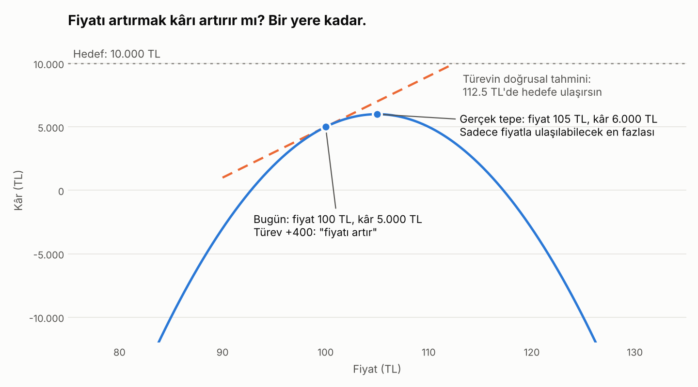

# sheetgrad

**ChatGPT'yi eğiten matematiği Excel tablona uygular.**

Bir Excel modelindeki sonucun hangi varsayıma ne kadar bağlı olduğunu hesaplar ve bir hedefe ulaşmak için neyin değişmesi gerektiğini önerir. Otomatik türev motoru, formül ayrıştırıcı ve optimizasyon algoritması dahil her şey sıfırdan, saf Python ile yazıldı.

<picture>
  <source media="(prefers-color-scheme: dark)" srcset="docs/fiyat_kar_dark.png">
  
</picture>

## Proje hakkında

### Amaç

Şirketlerde kararların büyük kısmı Excel modelleriyle veriliyor: bütçeler, fiyatlandırma, satış tahminleri, yatırım planları. Bu modeller onlarca varsayımdan (fiyat, maliyet, büyüme oranı, faiz...) bir sonuç (kâr, nakit akışı, geri ödeme süresi...) üretiyor. Modeli kuran ve kullanan herkes de er ya da geç aynı iki soruyu soruyor:

1. **Sonucu en çok hangi varsayım etkiliyor?** Hangi tahmine daha çok özen göstermeliyim, hangisi yanlış olursa sonuç çöker?
2. **Hedefe ulaşmak için neyi değiştirmeliyim?** Kârı 10.000 TL yapmak için fiyatı mı artırmalıyım, maliyeti mi düşürmeliyim, ikisini birden mi?

Bugün bu sorular çoğunlukla elle cevaplanıyor: bir hücreyi değiştir, sonuca bak, geri al, bir sonrakini dene. Girdi sayısı arttıkça bu hem yavaşlıyor hem de yanıltıcı oluyor, çünkü girdiler birbirini etkiliyor (fiyat artınca satış düşüyor) ve farklı birimlerdeki etkiler gözle karşılaştırılamıyor.

`sheetgrad`'ın amacı bu iki soruyu **matematiksel olarak doğru, hızlı ve kod bilmeyen birinin de kullanabileceği** şekilde cevaplamak: Excel dosyasını ve sonuç hücresini veriyorsun, gerisini o hallediyor. Dosyan hiçbir zaman değiştirilmiyor.

### Ne yapar?

| Özellik | Cevapladığı soru |
|---|---|
| **Duyarlılık analizi** | "Her girdi 1 birim veya %1 artarsa sonuç ne kadar değişir?" Tüm girdiler tek seferde, etkisine göre sıralı. |
| **Hedef arama** | "Sonucu X yapmak için girdileri en az nasıl değiştirmeliyim?" İstersen sadece seçtiğin hücrelere dokunarak. |
| **Ulaşılamazlık tespiti** | Hedef seçilen girdilerle imkânsızsa bunu söyler ve ulaşılabilecek en iyi noktayı gösterir. |
| **Uyarılar** | `IF` koşulu sınıra çok yakınsa, `MAX`'ta eşitlik varsa veya bir türev tanımsızsa sonucu sessizce yanlış göstermek yerine haber verir. |

### Kimin için?

- **İş analistleri ve finans ekipleri:** Bütçe ve fiyatlandırma modellerinde hangi varsayımın kritik olduğunu görmek, senaryo hazırlamak.
- **Küçük işletmeler ve girişimler:** "Başa baş noktasına ulaşmak için ne kadar satmam veya hangi fiyattan satmam gerek?" gibi sorular.
- **Öğrenciler ve eğitimciler:** Kısmi türevin, zincir kuralının ve gradyan inişinin gerçek bir problemde ne işe yaradığını görmek. Motor kısa ve okunabilir olduğu için yapay zekânın arkasındaki matematiği öğrenmek için de bir kaynak.

### Excel'in kendi araçlarından farkı

Excel'de bu sorulara yakın iki araç var:

- **Hedef Ara (Goal Seek)** tek bir girdi hücresini değiştirerek hedefe ulaşmaya çalışır. Birden fazla girdiyi birlikte ayarlayamaz ve hangi girdinin seçilmesi gerektiğini söylemez.
- **Çözücü (Solver)** birden fazla hücreyle optimizasyon yapabilen güçlü bir eklentidir, ama kurulumu ve ayarlanması uzmanlık ister ve "hangi girdi ne kadar önemli?" sorusuna doğrudan bir sıralama sunmaz.

`sheetgrad` her ikisini tek komutla yapıyor: önce **neyin önemli olduğunu** gösteriyor, sonra seçtiğin girdilerle **hedefe giden en kısa yolu** öneriyor. Komut satırından çalıştığı için bir otomasyona veya düzenli rapora da eklenebiliyor.

### Neden bu şekilde yazıldı?

Bu proje aynı zamanda bir öğrenme projesi. Amacım, yapay zekâ modellerinin nasıl eğitildiğini hazır bir kütüphane kullanarak değil, **temelden kurarak** anlamaktı: otomatik türev, geri yayılım ve gradyan inişi. Bu yüzden PyTorch gibi bir kütüphane kullanmak yerine motor sıfırdan yazıldı ve doğruluğu PyTorch ile karşılaştırılarak test edildi.

Bu kavramları sinir ağları yerine Excel modellerine uygulamamın sebebi, sonuçların herkes için anlaşılır olması: "Bu ağırlığın gradyanı 0.003" demek yerine "Fiyatı 1 TL artırırsan kârın 400 TL artar" diyebilmek. Altta yatan matematik ise aynı.

## Fiyatı artırırsam kâr artar mı?

Küçük bir işletmenin Excel'deki kâr modeli: fiyat 100 TL, kâr 5.000 TL. Hedef kârı ikiye katlamak.

Türev cevap veriyor: **fiyat 1 TL artarsa kâr 400 TL artar.** Bu oranla gidersek fiyatı 112.5 TL yapınca kâr 10.000 TL olur. Kulağa mantıklı geliyor.

Ama tabloda bir formül daha var: fiyat arttıkça satış düşüyor. Kâr, fiyatın bir parabolü ve tepesi **105 TL'de, 6.000 TL**. Sadece fiyatla oynayarak hedefe ulaşmak **imkânsız**. Türev bugün için doğru söylüyor ama yalnızca bugün için.

`sheetgrad` iki soruyu da cevaplıyor:

```bash
sheetgrad kar_modeli.xlsx B13
```
```
Kâr (B13) = 5,000.00

Girdi           Hücre            Değer   1 birim artarsa      %1 artarsa
──────────────────────────────────────────────────────────────────────────
Birim maliyet   B3               60.00         -2,000.00       -1,200.00  ████████████████████
Fiyat           B2              100.00           +400.00         +400.00  ███████
Maaşlar         B6           40,000.00             -1.00         -400.00  ███████
Reklam bütçesi  B4           20,000.00             +1.00         +200.00  ███
Kira            B5           15,000.00             -1.00         -150.00  ██
```

```bash
sheetgrad kar_modeli.xlsx B13 --hedef 10000 --degistir B2
```
```
✗ Hedefe ulaşılamadı.
  Seçilen girdilerle ulaşılabilen en yakın değer: 6,000.00

Fiyat           B2              100.00          105.00      +5.0%
```

```bash
sheetgrad kar_modeli.xlsx B13 --hedef 10000 --degistir B2,B4
```
```
✓ Hedefe ulaşıldı: 9,999.99

Reklam bütçesi  B4           20,000.00       23,086.30     +15.4%
Fiyat           B2              100.00          106.52      +6.5%
```

Fiyat tek başına yetmiyor; reklamla birlikte yetiyor. Bunu bulmak için hiçbir girdiyi elle oynatmak gerekmedi.

## Bu 15 satırlık tablodan çıkan üç şaşırtıcı sonuç

**1. Maaşlar, fiyat kadar önemli.** Ham türevlere bakınca maaşların etkisi −1, fiyatın +400; maaşlar 400 kat önemsiz görünüyor. Ama 1 TL fiyat %1'lik bir değişiklik, 1 TL maaş ise 40.000 TL içinde fark edilmez. Her girdi kendi değerinin %1'i kadar değiştirildiğinde ikisinin etkisi eşit çıkıyor: ±400 TL.

**2. En güçlü kaldıraç maliyette.** Birim maliyeti %1 düşürmek, fiyatı %1 artırmaktan üç kat fazla kâr getiriyor, çünkü satış hacmini etkilemiyor.

**3. Vergi formülü bir yapay sinir hücresi.** `=MAX(0, Kâr)*0.2`: kâr negatifse vergi yok, pozitifse %20. Bu, sinir ağlarının en yaygın aktivasyon fonksiyonu **ReLU** ile aynı şey, ve türevi de aynı şekilde alınıyor.

## 30 saniyede dene

```bash
git clone https://github.com/edpolat/sheetgrad.git
cd sheetgrad
pip install -e .
sheetgrad examples/kar_modeli.xlsx B13
```

Kendi tablonda denemek için dosya yolunu ve sonuç hücresini vermen yeterli. Girdi etiketleri, hücrenin solundaki metinden otomatik alınıyor.

## Fikir: Excel tablosu bir hesaplama grafıdır

`B13 = B10 - B12` yazdığında Excel, B13'ün B10'a ve B12'ye bağlı olduğunu bilir ve bir girdi değişince hücreleri doğru sırayla yeniden hesaplamak için onları **topolojik sıraya** dizer.

Sinir ağlarını eğiten **geri yayılım (backpropagation)** algoritması da aynı yapı üzerinde çalışır: aynı sırayı **tersten** gezip her adımda zincir kuralını uygular. `sheetgrad` Excel dosyasını okuyup her hücreyi bir düğüme çeviriyor ve bu grafa backprop uyguluyor.

Sonuç: Model 5 girdili de olsa 500 girdili de olsa, **tüm girdilerin etkisi tek bir geri geçişte** hesaplanıyor. Milyarlarca parametreli yapay zekâ modellerini eğitmeyi mümkün kılan özellik de bu.

Hedef arama ise yapay zekâ eğitiminin kendisi: hedefe uzaklık bir hata fonksiyonuna çevriliyor ve **gradyan inişiyle** küçültülüyor. Tek fark, ayarlanan parametrelerin sinir ağı ağırlıkları değil iş varsayımları olması.

## Kullanım

### Duyarlılık analizi

```bash
sheetgrad dosya.xlsx B13
```

Çıktıdaki iki sütun farklı sorulara cevap veriyor:
- **1 birim artarsa:** Kısmi türev. "Fiyat 1 TL artarsa kâr 400 TL artar."
- **%1 artarsa:** Girdinin kendi değerinin %1'i kadar artması. Sıralama bu sütuna göre yapılıyor; nedenini yukarıdaki ilk şaşırtıcı sonuç anlatıyor.

Girdi etiketleri, hücrenin solundaki metinden otomatik alınıyor.

### Hedef arama

```bash
sheetgrad dosya.xlsx B13 --hedef 10000                  # tüm girdileri kullanarak
sheetgrad dosya.xlsx B13 --hedef 10000 --degistir B2,B4  # sadece seçilen hücrelerle
```

### Diğer seçenekler

| Seçenek | Açıklama |
|---|---|
| `--sayfa Ad` | Birden fazla sayfa varsa hangisinin okunacağı (varsayılan: açık sayfa) |
| `--help` | Tüm seçenekler |

**Çıkış kodları:** `0` başarılı, `1` hata (dosya yok, formül hatası vb.), `2` hedefe ulaşılamadı. Otomasyon ve CI kullanımları için.

### Python'dan kullanım

```python
from sheetgrad.model import Model
from sheetgrad.optimize import goal_seek

model = Model.from_excel("kar_modeli.xlsx")

kar, satirlar = model.sensitivities("B13")
for s in satirlar:
    print(s["label"], s["gradient"], s["impact_1pct"])

# Dosyaya yazmadan "fiyat 110 olsaydı?"
print(model.run("B13", {"B2": 110}).data)

sonuc = goal_seek(model, "B13", 10000, cells=["B2", "B4"])
print(sonuc["reached"], sonuc["changes"])
```

## Nasıl çalışır?

Her parça sıfırdan yazıldı. Ayrıntıları merak edenler için:

<details>
<summary><b>1. Otomatik türev motoru (`engine.py`)</b></summary>

Her sayı, kendisini üreten işlemi hatırlayan bir `Value` nesnesine sarılıyor:

```python
from sheetgrad.engine import Value

fiyat, adet, maliyet, kira = Value(100), Value(50), Value(60), Value(500)
kar = fiyat * adet - maliyet * adet - kira
kar.backward()

fiyat.grad    # 50.0   = adet
adet.grad     # 40.0   = fiyat - maliyet
maliyet.grad  # -50.0  = -adet
```

Motor sadece **üç temel işlemin** türev kuralını biliyor: toplama, çarpma ve üs. Çıkarma (`a + (−1)·b`) ve bölme (`a · b⁻¹`) bunlardan kuruluyor; türevleri zincir kuralıyla kendiliğinden doğru çıkıyor. Ayrıca `exp`, `log` ve üssün değişken olduğu `aᵇ` (bileşik faiz formülleri için) destekleniyor.

`adet` örnekte iki yerde kullanılıyor; türevi iki yoldan gelen etkinin **toplamı** (+100 − 60 = 40). Bu, çok değişkenli zincir kuralının özü ve motorda türevlerin `=` ile değil `+=` ile biriktirilmesinin sebebi.

</details>

<details>
<summary><b>2. Formül ayrıştırıcı (`formula.py`)</b></summary>

`"=B2*(1+B3)^B4"` gibi bir formül önce parçalara ayrılıyor (**tokenizer**), sonra işlem önceliğine göre birleştiriliyor (**recursive descent parser**). Ayrıştırıcı ayrı bir sözdizimi ağacı kurmuyor; doğrudan `Value` nesneleriyle hesap yaptığı için hesaplama grafı ayrıştırma sırasında kendiliğinden oluşuyor.

Excel'in işlem kuralları matematikten ve Python'dan farklı, ve ayrıştırıcı Excel'e sadık:

| Formül | Matematik / Python | Excel ve sheetgrad |
|---|---|---|
| `-2^2` | −4 | **4** (eksi işareti üsten önce) |
| `2^3^2` | 512 | **64** (üsler soldan sağa) |
| `ROUND(2.5, 0)` | 2 (Python: en yakın çifte yuvarlar) | **3** (yarım her zaman yukarı) |

</details>

<details>
<summary><b>3. Excel modelini okuma (`model.py`)</b></summary>

Çıktı hücresinden başlayarak bağlı olduğu hücreler özyinelemeli olarak okunuyor; tablonun alakasız kısımlarına hiç bakılmıyor.

- **Girdi:** Elle yazılmış her sayı. Formül içeren hücreler hesaplanan ara sonuçlar.
- **Önbellek:** Birden fazla yerde kullanılan bir hücre bir kez hesaplanıyor. Bu hem hız hem doğruluk için şart: türevin her yoldan gelen etkiyi toplayabilmesi için o hücreyi kullanan herkesin **aynı** `Value` nesnesini görmesi gerekiyor.
- **Döngüsel başvuru tespiti:** `A1 → B1 → C1 → A1` gibi döngüler, o an hesaplanmakta olan hücreler takip edilerek yakalanıyor ve zincir hata mesajında gösteriliyor.
- **Hata mesajları hücreyi söylüyor:** `B9 hücresinde (=VLOOKUP(...)): Desteklenmeyen fonksiyon: VLOOKUP`

</details>

<details>
<summary><b>4. Birim sorunu ve "%1 etkisi"</b></summary>

Ham türevler yanıltıcı olabilir. Örnek modelde maaşların türevi −1, fiyatın türevi +400; maaşlar önemsiz görünüyor. Ama fiyatı 1 TL artırmak %1'lik bir değişiklik, maaşları 1 TL artırmak ise 40.000 TL içinde fark edilmez bir değişiklik. İkisini "1 birim" üzerinden karşılaştırmak, farklı birimleri karşılaştırmak demek.

Çözüm, her girdiyi kendi değerinin %1'i kadar değiştirmek:

```
%1 etkisi = türev × değer × 0.01
Maaşlar:   −1 × 40.000 × 0.01 = −400     (fiyat kadar etkili)
```

Ekonomideki **esneklik** kavramının karşılığı. Sıralama bu ölçüte göre yapılıyor.

</details>

<details>
<summary><b>5. Hedef arama (`optimize.py`)</b></summary>

Hedefe uzaklık bir hata fonksiyonuna dönüştürülüyor ve gradyan inişiyle küçültülüyor:

```
hata = ((sonuç − hedef) / ölçek)²
```

Bu, yapay zekâ eğitimiyle birebir aynı döngü; tek fark, ayarlanan parametrelerin sinir ağı ağırlıkları değil iş varsayımları olması. Gradyan inişini gerçek modellerde güvenilir kılmak için dört ek önlem alındı:

**Ölçeklenmiş değişkenler.** Algoritma girdileri doğrudan değil, `yeni = eski × (1 + u)` şeklinde yüzde olarak hareket ettiriyor. Böylece TL, adet ve oran gibi farklı birimler aynı ölçekte. Bunun güzel bir sonucu var: `u = 0`'dan başlayan gradyan inişi, birçok olası çözüm arasından **mevcut plana en yakın olanı** bulma eğiliminde (doğrusal modellerde bu kesin bir sonuç). `A1 + A2 = 20` toplamını 30 yapmak için ikisini de 15 yapıyor, birini 20 yapmak yerine.

**Kendi kendini ayarlayan adım boyu.** Kullanıcıya öğrenme oranı sorulmuyor. Her adımda hata azalırsa adım büyütülüyor, azalmazsa yarıya indirilip tekrar deneniyor (*backtracking line search*). Hatayı artıran bir adım hiçbir zaman kabul edilmiyor; bu yüzden sabit öğrenme oranıyla görülen salınma ve patlama sorunları oluşmuyor.

**Adım başına %2 sınırı.** Geliştirme sırasında bir test öğretici bir şekilde kaldı: Sadece fiyatla kârı 5.500 yapmanın iki çözümü var (101.46 ve 108.54, parabolün iki tarafı). Başlangıç 100 olduğu için yakın olanı bulması beklenirken algoritma büyük ilk adımlarla tepeyi aşıp uzaktaki çözüme düştü. Her adımda hiçbir girdinin kendi değerinin %2'sinden fazla oynamaması (basit bir *güven bölgesi*) bunu çözdü ve gerçek önerileri de belirgin şekilde değiştirdi.

**Negatife düşmeme.** Fiyat ve bütçe gibi başlangıçta negatif olmayan girdiler her adımdan sonra sıfırda tutuluyor (*izdüşümlü gradyan inişi*).

Excel dosyasına hiçbir zaman yazılmıyor; tüm denemeler bellekte yapılıyor.

</details>

<details>
<summary><b>6. Türevlenemeyen fonksiyonlar</b></summary>

`IF`, `MAX`, `ABS` ve `ROUND` gibi fonksiyonların grafiklerinde köşeler, sıçramalar ve basamaklar var. Bu noktalarda türev tanımsız veya yanıltıcı. Yapay zekâda da aynı sorunlar yaşanıyor ve buradaki çözümlerin üçü oradan geliyor.

**`MAX` / `MIN`: türev kazanana gider.** `MAX(3, 7, 5)` için türev yalnızca 7'ye akıyor. Örnek modeldeki vergi formülü `=MAX(0, Kâr)*0.2`, sinir ağlarının en yaygın aktivasyon fonksiyonu **ReLU**'nun ta kendisi.

**`IF`: sadece seçilen dal hesaplanıyor.** Excel'de `=IF(A1=0, 0, B1/A1)` gibi formüller sıfıra bölmeyi önlemek için yaygın. Fonksiyon argümanlarını önceden hesaplayan bir ayrıştırıcı burada tam da önlenmek istenen hatayı üretirdi. `sheetgrad` önce koşulu hesaplıyor, seçilmeyen dalı ise parantez derinliğini sayarak hiç hesaplamadan atlıyor (*tembel değerlendirme*), tıpkı Excel gibi.

IF'in bir kör noktası var: koşul sınıra yakınsa (`fiyat = 100.5` iken `IF(fiyat > 100, ...)`) küçük bir değişiklik sonucu başka bir dala sıçratabilir ve türev bu sıçramayı göremez. Bu durumda rapor bir uyarı veriyor.

**`ROUND`: straight-through estimator.** `ROUND`'un gerçek türevi neredeyse her yerde sıfır; dürüstçe uygulansaydı `=ROUND(fiyat*adet, 0)` gibi bir formülde fiyat hiçbir şeyi etkilemiyor görünürdü. Bunun yerine ileri hesaplamada gerçekten yuvarlanıyor, geri hesaplamada ise türev yuvarlama yokmuş gibi geçiriliyor. Aynı hile, telefonlarda çalışan *quantized* sinir ağlarının eğitiminde kullanılıyor. Rapor bunu bir uyarıyla belirtiyor.

**Tanımsız türevler gizlenmiyor.** `ABS`'nin sıfırdaki köşesi, `MAX`'taki eşitlikler, negatif tabanlı değişken üsler gibi durumlar ya rapora uyarı olarak ekleniyor ya da türev "tanımsız" olarak gösteriliyor. İlke: yanlış bir sayı göstermektense bilinmediğini söylemek.

</details>

## Desteklenenler

| Tür | Destek |
|---|---|
| İşlemler | `+` `-` `*` `/` `^`, işaret (`-A1`), parantezler |
| Karşılaştırmalar | `=` `<>` `<` `>` `<=` `>=` |
| Referanslar | `B2`, `$B$2`, aralıklar (`A1:B5`, fonksiyon içinde) |
| Fonksiyonlar | `SUM` `AVERAGE` `MIN` `MAX` `ABS` `ROUND` `IF` `EXP` `LN` |
| Diğer | Boş hücre = 0 |

Türkçe Excel kullanıyorsanız da sorun yok: Excel `TOPLA(A1;A3)` gibi formülleri dosyaya her zaman İngilizce isimler ve virgülle (`SUM(A1,A3)`) kaydediyor.

## Doğrulama

113 test, motorun her parçasını üç bağımsız yoldan doğruluyor:

- **Elle hesaplanan türevler:** Kâr modeli, bileşik faiz ve vergi formülü gibi örneklerde türevler kağıt üzerinde hesaplanıp karşılaştırılıyor.
- **Sayısal türev:** Türevin tanımına geri dönülerek, `(f(x+h) − f(x−h)) / 2h`, motorun sonucu bağımsız olarak kontrol ediliyor.
- **PyTorch ile karşılaştırma:** Aynı fonksiyon hem `sheetgrad` hem PyTorch ile hesaplanıp değerler ve tüm türevler karşılaştırılıyor. PyTorch kurulu değilse bu testler atlanıyor; paket PyTorch'a bağımlı değil.

Excel'e özgü testler; işlem önceliği tuhaflıkları, IF'in seçilmeyen dalının hiç okunmaması, döngüsel başvurular ve hatalı formüller gibi durumları kapsıyor.

## Sınırlamalar

- **Fonksiyon kapsamı:** Excel'de 400'den fazla fonksiyon var; yukarıdaki tablo dışındakiler (`VLOOKUP`, `SUMIF`, `INDEX`, tarih ve metin fonksiyonları vb.) desteklenmiyor ve hücre adıyla birlikte hata veriyor.
- **Tek sayfa:** Başka bir sayfaya referans (`=Sayfa2!A1`) desteklenmiyor.
- **Hedef aramanın önerisi tek değil:** Birden fazla girdiyle bir hedefe ulaşmanın sonsuz yolu var. Araç mevcut plana yüzde olarak en yakın olanı öneriyor; hangi değişikliğin uygulanabilir olduğuna kullanıcı karar vermeli (`--degistir` bunun için var).
- **Yerel çözüm:** Doğrusal olmayan modellerde gradyan inişi en yakın iyi noktayı bulur; en iyisini bulacağının garantisi yok.
- **Türevler yerel bilgidir:** "%1 artarsa" küçük değişiklikler için geçerli. Büyük değişikliklerde, özellikle `IF` ve `MAX` gibi fonksiyonlar varsa, gerçek etki farklı olabilir.
- **Çok büyük modeller:** Hücreler özyinelemeli okunduğu için binlerce hücrelik zincirler Python'un özyineleme sınırına takılabilir.

## Proje yapısı

```
sheetgrad/
├── src/sheetgrad/
│   ├── engine.py      # Otomatik türev motoru (Value, backward)
│   ├── formula.py     # Excel formül tokenizer'ı ve ayrıştırıcısı
│   ├── model.py       # Excel dosyasını hesaplama grafına çevirme
│   ├── optimize.py    # Hedef arama (gradyan inişi)
│   └── cli.py         # Komut satırı aracı
├── tests/             # 113 test
├── examples/
│   └── kar_modeli.xlsx
└── scripts/
    ├── ornek_excel.py      # Örnek modeli üretir
    └── gradyan_inisi.py    # Motorla gradyan inişi deneyleri
```

## Geliştirme

```bash
git clone https://github.com/edpolat/sheetgrad.git
cd sheetgrad
python -m venv .venv
source .venv/bin/activate
pip install -e . pytest torch
pytest
```

## Lisans

MIT
